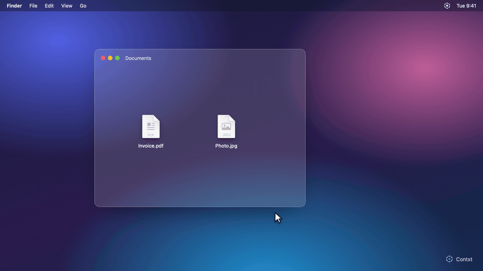

<div align="center">


# Contxt

**Drag-and-drop everything.** A radial launcher for macOS: drop files on a circle to move, copy, open, share or process them.

[](https://github.com/EdiBianco/Contxt/releases/latest)
[](https://github.com/EdiBianco/Contxt/actions/workflows/build.yml)


[**Download the latest release**](https://github.com/EdiBianco/Contxt/releases/latest)



</div>

---

## How it works

Press **⌘⇧D** anywhere. A ring of circles appears under your cursor, each one a place a file can go. Drag files out of Finder, hover a circle to see what will happen, and let go.

The center circle is the **Drop Zone**, a temporary stack for collecting files from several places before moving them all at once.

## Features

**Drop targets**

| Target | What a drop does |
| --- | --- |
| **Folders** | Moves or copies the files. You choose the default per folder, and hold **⌥** to do the other one. |
| **Apps** | Opens the files with that app. |
| **Scripts** | Runs your script with the dropped file paths as arguments. |
| **Shortcuts** | Runs a macOS Shortcut with the files as its input. |
| **Contacts** | Opens Messages or Mail with the files attached and the contact as recipient. |
| **WhatsApp, Telegram** | Opens the chat with that contact and copies the files so you can press **⌘V** to attach them. |
| **Common actions** | Compose a message or email, import to Photos, move to Trash. |

**On the ring**

- A translucent pill in the center spells out the action for the hovered circle, for example *Move to Documents* or *Run 'Resize Images'*. It switches live when you press **⌥**.
- Icons are the real Finder icons of your folders, apps and scripts, with a small badge showing the kind of action.
- Hold a dragged file on a folder for a moment and Finder opens it, so you can drop into a subfolder without crowding the ring.
- Drag a circle around the ring and the others slide aside to make room. **Settings → Ring Order** has the same thing as a list.

**Drop Zone**

- Drop files on the center circle to stack them. Nothing is moved or copied at that point, so the originals are never at risk.
- Drag the center circle into any Finder folder and the whole stack goes there in one go.

**Settings**

- Add folders, apps, scripts, Shortcuts and contacts from the menu bar icon, then **Settings…** (⌘,).
- Light, dark or system appearance, orb size slider, rebindable activation hotkey, start at login.

**Updates**

- Contxt checks GitHub for new releases every day, week or month (or never), and you can check manually from the menu bar.
- Updates download in the background and are verified against the app's own signing identity. They install and relaunch when Contxt is idle, or when you choose **Restart to Update**.

## Install

Contxt is signed but not notarized, so macOS Gatekeeper blocks a downloaded copy on first launch (on macOS 15 and later, right-click **Open** no longer works for it). Pick one of these:

**Terminal install (no warning).** The script downloads the latest release with curl, which does not set the quarantine flag, and installs it in Applications. [Read it first](scripts/install.sh) if you like.

```sh
curl -fsSL https://thecontxt.com/install.sh | sh
```

**DMG install.**

1. Download `Contxt-<version>.dmg` from the [latest release](https://github.com/EdiBianco/Contxt/releases/latest).
2. Open it and drag **Contxt** onto **Applications**.
3. If macOS blocks the app, run this once in Terminal (the command is also printed on the DMG window), or open **System Settings > Privacy & Security** and click **Open Anyway**:

   ```sh
   xattr -dr com.apple.quarantine /Applications/Contxt.app
   ```

Then press **⌘⇧D**. Contxt lives in the menu bar, with no Dock icon.

### Permissions

| Permission | Why | When it asks |
| --- | --- | --- |
| Files & Folders | Move or copy into Desktop, Documents and Downloads | First launch |
| Contacts | List people to add as destinations | When you open Add Contact |

No Input Monitoring or Accessibility access is needed. The hotkey is a system hotkey registered through Carbon.

## Scripts

A script destination is called as `script.sh file1 file2 …`. Executable files run directly, so a shebang works. Anything else runs through `zsh`.

```sh
#!/bin/zsh
for f in "$@"; do
  sips -Z 1600 "$f"
done
```

## Build from source

```sh
swift build -c release
```

Releases are built and signed by GitHub Actions (see [`.github/workflows/build.yml`](.github/workflows/build.yml)). A stable signing identity keeps macOS permission grants across updates.

## Credits

The ring's angle and wedge math is ported from [Kando](https://github.com/kando-menu/kando) (MIT).
